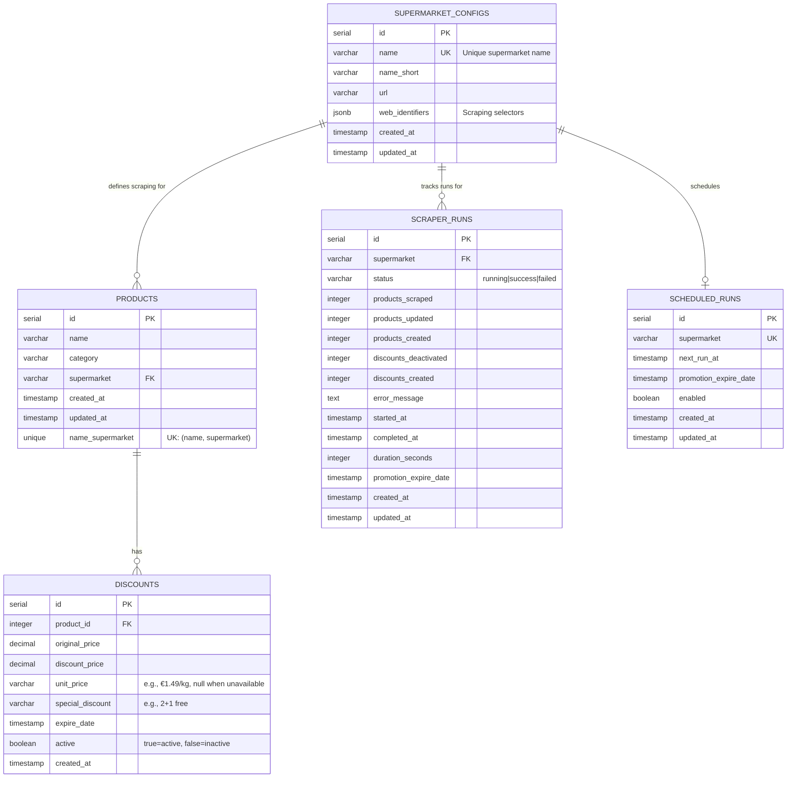
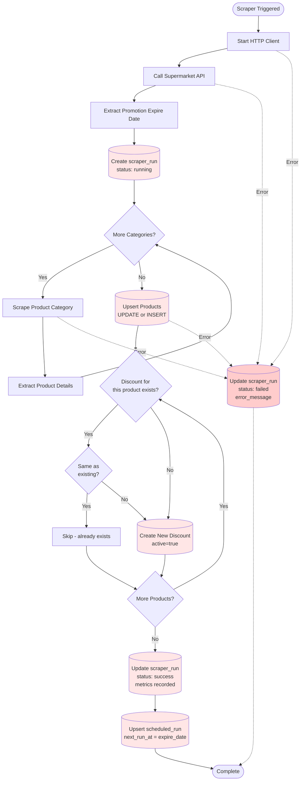
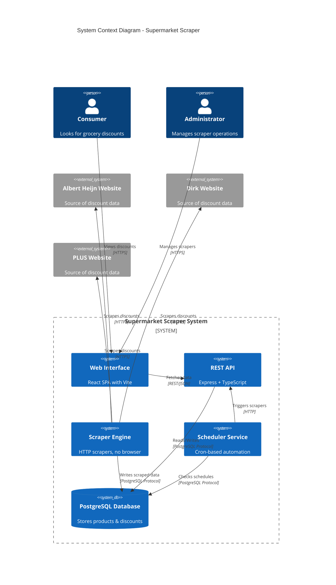

# Data model

Tables, indexes, data flow, configuration data and schema migrations. Part of the [functional design](../FUNCTIONAL_DESIGN.md).

## FR-002: Data Storage & Management

| ID        | Requirement                                                            | Priority | Status         |
| --------- | ---------------------------------------------------------------------- | -------- | -------------- |
| FR-002.1  | System SHALL store all data in PostgreSQL database                     | HIGH     | ✅ Implemented |
| FR-002.2  | System SHALL enforce unique constraint on product (name + supermarket) | HIGH     | ✅ Implemented |
| FR-002.3  | System SHALL update existing products instead of creating duplicates   | HIGH     | ✅ Implemented |
| FR-002.4  | System SHALL maintain active/inactive status for discounts             | HIGH     | ✅ Implemented |
| FR-002.5  | System SHALL preserve historical discount data                         | MEDIUM   | ✅ Implemented |
| FR-002.6  | System SHALL use optimized indexes for fast queries                    | HIGH     | ✅ Implemented |
| FR-002.7  | System SHALL support full-text search on product names                 | MEDIUM   | ✅ Implemented |
| FR-002.8  | System SHALL automatically update timestamps on record changes         | LOW      | ✅ Implemented |
| FR-002.9  | System SHALL cascade delete discounts when products are deleted        | MEDIUM   | ✅ Implemented |
| FR-002.10 | System SHALL store supermarket configurations in database              | MEDIUM   | ✅ Implemented |

## 5. Data Structure

### 5.1 Entity Relationship Diagram



### 5.2 Table Specifications

#### Table: supermarket_configs

**Purpose:** Store configuration for each supermarket including scraping identifiers

| Column          | Type         | Constraints      | Description                                  |
| --------------- | ------------ | ---------------- | -------------------------------------------- |
| id              | SERIAL       | PRIMARY KEY      | Auto-incrementing ID                         |
| name            | VARCHAR(255) | NOT NULL, UNIQUE | Full supermarket name (e.g., "Albert Heijn") |
| name_short      | VARCHAR(50)  | NULL             | Short name (e.g., "AH")                      |
| url             | VARCHAR(512) | NOT NULL         | Base URL for scraping                        |
| web_identifiers | JSONB        | NOT NULL         | CSS selectors and scraping configuration     |
| created_at      | TIMESTAMP    | DEFAULT NOW()    | Record creation timestamp                    |
| updated_at      | TIMESTAMP    | DEFAULT NOW()    | Last update timestamp                        |

**Indexes:**

- `idx_supermarket_name` on `name`

**Sample Data:**

```json
{
  "name": "Albert Heijn",
  "name_short": "AH",
  "url": "https://www.ah.nl/bonus",
  "web_identifiers": {
    "cookieDecline": "button#decline-cookies",
    "promotionExpireDate": "div.promotion-period",
    "productCategories": ["category1", "category2"],
    "products": "div.product-card",
    "promotionProducts": {
      "name": "h3.product-name",
      "price": "span.price",
      "discount": "span.discount"
    }
  }
}
```

#### Table: products

**Purpose:** Store unique products identified by name + supermarket combination

| Column      | Type         | Constraints   | Description                   |
| ----------- | ------------ | ------------- | ----------------------------- |
| id          | SERIAL       | PRIMARY KEY   | Auto-incrementing ID          |
| name        | VARCHAR(500) | NOT NULL      | Product name                  |
| category    | VARCHAR(255) | NOT NULL      | Product category              |
| supermarket | VARCHAR(255) | NOT NULL      | Supermarket name                                        |
| product_url | TEXT         | NULLABLE      | Direct URL to the offer page on the supermarket website |
| created_at  | TIMESTAMP    | DEFAULT NOW() | First time product was seen   |
| updated_at  | TIMESTAMP    | DEFAULT NOW() | Last time product was updated |

**Constraints:**

- UNIQUE(name, supermarket) - Ensures no duplicate products per supermarket

**Indexes:**

- `idx_product_name` on `name`
- `idx_product_category` on `category`
- `idx_product_supermarket` on `supermarket`
- `idx_product_name_supermarket` on `(name, supermarket)`
- `idx_product_category_supermarket` on `(category, supermarket)`
- `idx_product_name_fulltext` on `to_tsvector('english', name)` (GIN index)

**Business Rules:**

- Products are updated (not recreated) when same name+supermarket is scraped again
- Products can have multiple discounts over time
- Products are never automatically deleted

#### Table: discounts

**Purpose:** Store discount information linked to products with active/inactive lifecycle

| Column           | Type          | Constraints                 | Description                             |
| ---------------- | ------------- | --------------------------- | --------------------------------------- |
| id               | SERIAL        | PRIMARY KEY                 | Auto-incrementing ID                    |
| product_id       | INTEGER       | NOT NULL, FK → products(id) | Reference to product                    |
| original_price   | DECIMAL(10,2) | NOT NULL, DEFAULT 0         | Pre-discount price                      |
| discount_price   | DECIMAL(10,2) | NOT NULL                    | Discounted price                        |
| unit_price       | VARCHAR(50)   | NULL                        | Unit price string (e.g., "€1.49/kg", "€0.99/l", "€0.50/st"); null when not available |
| special_discount | VARCHAR(255)  | NULL                        | Special conditions (e.g., "2+1 gratis") |
| expire_date      | TIMESTAMP     | NOT NULL                    | When discount expires                   |
| active           | BOOLEAN       | NOT NULL, DEFAULT true      | Is discount currently active            |
| created_at       | TIMESTAMP     | DEFAULT NOW()               | When discount was first scraped         |

**Cascade:**

- ON DELETE CASCADE - Discounts deleted when product is deleted

**Indexes:**

- `idx_discount_product_id` on `product_id`
- `idx_discount_expire_date` on `expire_date`
- `idx_discount_price_range` on `discount_price`
- `idx_discount_active` on `active`
- `idx_discount_product_expire` on `(product_id, expire_date)`
- `idx_discount_product_active` on `(product_id, active)`

**Business Rules:**

- When scraper runs, existing active discounts for products not found are marked `active=false`
- When scheduler runs, discounts with `expire_date < NOW()` are marked `active=false`
- Only active discounts (`active=true`) are returned by API and shown in web interface
- Inactive discounts are preserved for historical analysis

#### Table: scraper_runs

**Purpose:** Complete audit trail of all scraper executions with detailed metrics

| Column                | Type         | Constraints     | Description                       |
| --------------------- | ------------ | --------------- | --------------------------------- |
| id                    | SERIAL       | PRIMARY KEY     | Auto-incrementing ID              |
| supermarket           | VARCHAR(255) | NOT NULL        | Supermarket name                  |
| status                | VARCHAR(50)  | NOT NULL, CHECK | 'running', 'success', or 'failed' |
| products_scraped      | INTEGER      | DEFAULT 0       | Total products found by scraper   |
| products_updated      | INTEGER      | DEFAULT 0       | Existing products updated         |
| products_created      | INTEGER      | DEFAULT 0       | New products created              |
| discounts_deactivated | INTEGER      | DEFAULT 0       | Old discounts marked inactive     |
| discounts_created     | INTEGER      | DEFAULT 0       | New discounts created             |
| error_message         | TEXT         | NULL            | Error details if failed           |
| started_at            | TIMESTAMP    | DEFAULT NOW()   | When run started                  |
| completed_at          | TIMESTAMP    | NULL            | When run completed                |
| duration_seconds      | INTEGER      | NULL            | Total run time                    |
| promotion_expire_date | TIMESTAMP    | NULL            | Expiry date of scraped promotion  |
| created_at            | TIMESTAMP    | DEFAULT NOW()   | Record creation timestamp         |
| updated_at            | TIMESTAMP    | DEFAULT NOW()   | Last update timestamp             |

**Indexes:**

- `idx_scraper_runs_supermarket` on `supermarket`
- `idx_scraper_runs_status` on `status`
- `idx_scraper_runs_started_at` on `started_at DESC`
- `idx_scraper_runs_supermarket_status` on `(supermarket, status)`

**Business Rules:**

- Run created with status='running' before scraper starts
- Updated to status='success' on successful completion
- Updated to status='failed' with error_message on failure
- duration_seconds calculated as difference between completed_at and started_at

#### Table: scheduled_runs

**Purpose:** Manage automatic scheduling of scraper runs based on promotion cycles

| Column                | Type         | Constraints            | Description                                     |
| --------------------- | ------------ | ---------------------- | ----------------------------------------------- |
| id                    | SERIAL       | PRIMARY KEY            | Auto-incrementing ID                            |
| supermarket           | VARCHAR(255) | NOT NULL, UNIQUE       | Supermarket name (one schedule per supermarket) |
| next_run_at           | TIMESTAMP    | NOT NULL               | When scraper should run next                    |
| promotion_expire_date | TIMESTAMP    | NOT NULL               | Current promotion expiry date                   |
| enabled               | BOOLEAN      | NOT NULL, DEFAULT true | Is scheduled run enabled                        |
| created_at            | TIMESTAMP    | DEFAULT NOW()          | Record creation timestamp                       |
| updated_at            | TIMESTAMP    | DEFAULT NOW()          | Last update timestamp                           |

**Indexes:**

- `idx_scheduled_runs_supermarket` on `supermarket`
- `idx_scheduled_runs_next_run_at` on `next_run_at`
- `idx_scheduled_runs_enabled` on `enabled`

**Business Rules:**

- Scheduler checks every minute for rows where `next_run_at <= NOW() AND enabled=true`
- After successful scraper run, `next_run_at` is calculated based on new `promotion_expire_date`
- Typically scheduled to run on or just after promotion expiry (the most common end date of the run's offers)
- Can be disabled per supermarket via `enabled=false`

### 5.3 Database Indexes Strategy

#### Performance Optimization

**Full-Text Search:**

```sql
CREATE INDEX idx_product_name_fulltext
ON products USING gin(to_tsvector('english', name));
```

- Enables fast text search across product names
- 10-15x faster than LIKE queries
- Supports weighted relevance ranking

**Composite Indexes:**

```sql
CREATE INDEX idx_product_name_supermarket ON products(name, supermarket);
CREATE INDEX idx_discount_product_active ON discounts(product_id, active);
```

- Optimizes common query patterns
- Reduces need for multiple index scans
- Improves JOIN performance

**Partial Indexes (Considered but not implemented):**

```sql
-- Not used because NOW() is not immutable in PostgreSQL
-- CREATE INDEX idx_discount_active_future ON discounts(product_id)
-- WHERE active = true AND expire_date > NOW();
```

### 5.4 Data Flow Diagram



## 5.6 Configuration Data Structure

### Web Identifiers (JSONB)

**Purpose:** Store CSS selectors and scraping configuration per supermarket

**Schema:**

```typescript
interface WebIdentifiers {
  cookieDecline: string; // CSS selector for cookie decline button
  promotionExpireDate: string; // CSS selector for promotion end date
  productCategories: string[]; // Array of category identifiers
  products: string; // CSS selector for product cards
  promotionProducts: {
    name: string; // CSS selector for product name
    originalPrice: string; // CSS selector for original price
    discountPrice: string; // CSS selector for discount price
    specialDiscount: string; // CSS selector for special offers
  };
}
```

**Benefits:**

- Easy to update selectors without code changes
- Supports per-supermarket customization
- Stored in database for runtime flexibility
- Can be modified via database migrations

## 5.7 Schema Migrations

**Purpose:** Keep the schema of long-lived deployments in sync with the code that queries it

The database image copies `schema.sql` and `migrate.sql` into
`/docker-entrypoint-initdb.d/`, but PostgreSQL only executes those scripts when the
data directory is **empty**. A deployment whose volume already exists therefore never
receives columns added after that volume was created, which causes runtime errors such
as `column "product_url" of relation "products" does not exist`.

To close that gap, the scraper API applies migrations itself:

- Migrations are numbered SQL files in `scraper/migrations/` (`NNN_name.sql`), applied
  in filename order by `runMigrations()` in `scraper/src/data/Migrations.ts`.
- `runMigrations()` executes on every API startup, after the connection test succeeds
  and before the HTTP server starts accepting requests.
- Applied files are recorded in `schema_migrations`; each file runs in its own
  transaction, so a failed file is retried on the next start instead of skipped.
- Every statement must be safe to run repeatedly (`ADD COLUMN IF NOT EXISTS` and
  similar), because fresh installs get `schema.sql` first and then run every file too.
  New changes go in a new file; existing files are never edited or removed.

**Current migrations:**

| File                    | Changes                                                                 |
| ----------------------- | ----------------------------------------------------------------------- |
| `001_catalog.sql`       | Catalog columns on `products`, `price_history`, `catalog_runs`          |
| `002_offer_columns.sql` | `products.product_url`, `discounts.unit_price` for pre-existing volumes |
| `003_price_source.sql`  | `products.price_source` (origin of the catalog regular price)          |
| `004_quantity.sql`      | `products.quantity_value`, `products.quantity_unit` (pack quantity in kg, l or stuk) |
| `005_product_matching.sql` | `products.ean`, `products.match_brand`, `products.match_tokens` and their indexes (same product across supermarkets, FR-008) |
| `007_article_number.sql` | `products.article_number` (Lidl permanent article number) and `products.price_observed_at` (when the supermarket itself last showed the regular price, FR-007.14) |

**Result:** a redeploy of the scraper API is sufficient to bring an existing database
up to date — no manual `psql` intervention and no volume reset.

## 5.8 System Architecture Diagram



---

## 9.2 Database Query Examples

**Find all active discounts expiring soon:**

```sql
SELECT p.name, p.supermarket, d.discount_price, d.expire_date
FROM products p
INNER JOIN discounts d ON p.id = d.product_id
WHERE d.active = true
  AND d.expire_date BETWEEN NOW() AND NOW() + INTERVAL '3 days'
ORDER BY d.expire_date ASC;
```

**Get scraper success rate per supermarket:**

```sql
SELECT
  supermarket,
  COUNT(*) as total_runs,
  COUNT(*) FILTER (WHERE status = 'success') as successful_runs,
  ROUND(100.0 * COUNT(*) FILTER (WHERE status = 'success') / COUNT(*), 2) as success_rate
FROM scraper_runs
GROUP BY supermarket;
```

**Find products with most discount changes:**

```sql
SELECT
  p.name,
  p.supermarket,
  COUNT(d.id) as discount_count
FROM products p
INNER JOIN discounts d ON p.id = d.product_id
GROUP BY p.id, p.name, p.supermarket
ORDER BY discount_count DESC
LIMIT 10;
```
