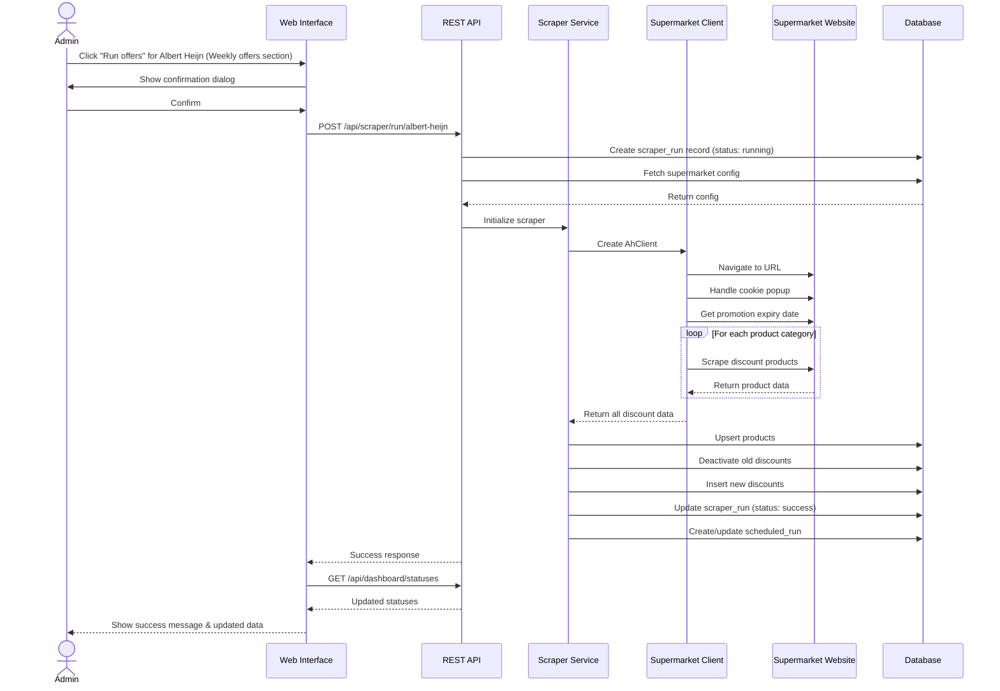
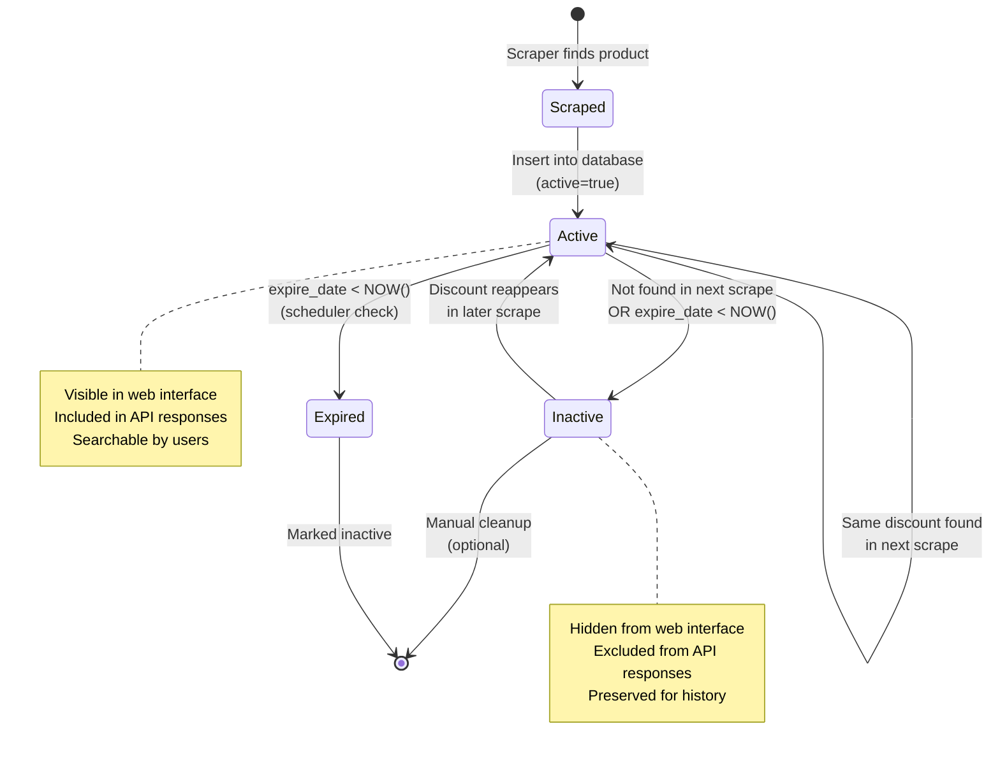
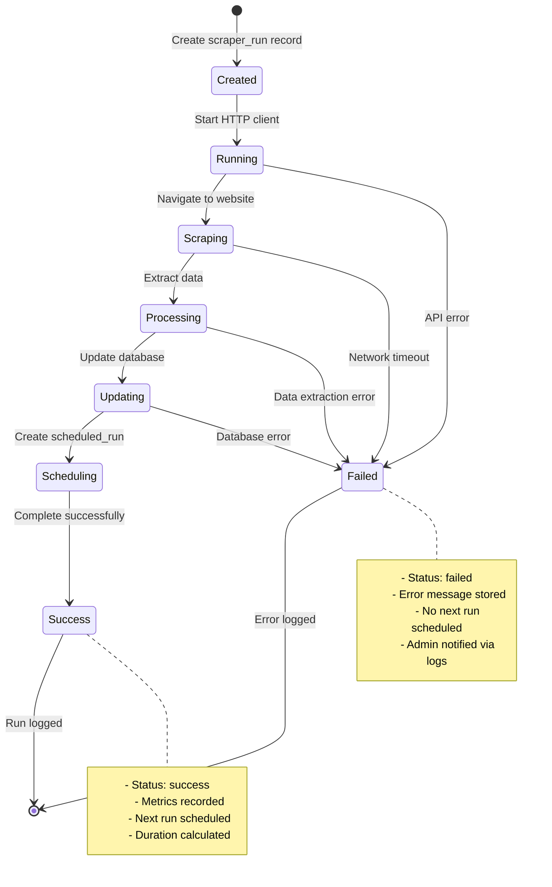

# Weekly offer scraping

Fetching the weekly offers per supermarket, manual runs, run states and the discount lifecycle. Part of the [functional design](../FUNCTIONAL_DESIGN.md).

## Epic 2: Scraper Management

```
US-004: Trigger Manual Scraper Run
As an administrator
I want to manually trigger a scraper for a specific supermarket
So that I can get fresh data on demand

Acceptance Criteria:
- Button to trigger each supermarket scraper
- Confirmation dialog before running
- Visual feedback during execution
- Success/failure notification
- Updated data immediately visible
```

```
US-005: Monitor Scraper Performance
As an administrator
I want to view scraper run history and metrics
So that I can ensure the system is functioning properly

Acceptance Criteria:
- View all scraper runs with timestamps
- See success/failure status
- View products scraped/created/updated counts
- View run duration
- Filter by supermarket
- Paginated results
```

```
US-006: View System Statistics
As an administrator
I want to see overall system statistics
So that I can understand system health at a glance

Acceptance Criteria:
- Total number of runs
- Overall success rate
- Total active products
- Unique products count
- Next scheduled run time
```

## Use Case 2: Run Scraper Manually



**Preconditions:**

- Administrator has access to Configurations page
- Database is accessible
- Target supermarket website is reachable
- Scraper is not already running for this supermarket

**Main Flow:**

1. Administrator navigates to Configurations page
2. Administrator clicks "Run offers" for the desired supermarket in the Weekly offers section
3. System displays confirmation dialog
4. Administrator confirms action
5. System creates scraper_run record with "running" status
6. Scraper calls the supermarket's API or site data over HTTP
7. Scraper retries rate limits and server errors
8. Scraper skips products outside the weekly offers
9. Scraper extracts promotion expiration date
10. For each product category:
    - Scraper finds discount products
    - Scraper extracts product details (name, prices, category)
11. System upserts products to database
12. System marks old discounts as inactive
13. System creates new discount records
14. System updates scraper_run to "success"
15. System schedules next run based on promotion expiry
16. Web interface refreshes to show new data

**Postconditions:**

- New/updated products exist in database
- Old discounts marked as inactive (active=false)
- New discounts created with active=true
- Scraper run logged with metrics
- Next run scheduled
- Administrator sees success confirmation

**Alternative Flows:**

- **6a**: Supermarket API unreachable → Log error, update run status to "failed"
- **7a**: Website unreachable → Timeout, mark run as "failed"
- **8a**: Cookie popup not found → Log warning, continue
- **10a**: No products found → Log warning, complete with 0 products
- **11a**: Database error → Rollback transaction, mark run as "failed"

## FR-001: Web Scraping Engine

| ID        | Requirement                                                                  | Priority | Status         |
| --------- | ---------------------------------------------------------------------------- | -------- | -------------- |
| FR-001.1  | System SHALL scrape discount data from Albert Heijn: one discount per product (not per promotion group such as "Alle Felix"), from the AH mobile API product search with the bonus filter, per top-level category. Only the weekly store bonus (`promotionType` NATIONAL) is kept; online-only, Etos, Gall & Gall, the long-running "Voordeelshop" and standing volume discounts are skipped. Each discount has the regular price, the bonus price per item (multi-buy labels worked out per item), the pack size and price per unit, its own end date, the group name in the special discount text, and `externalId` = webshopId | HIGH     | ✅ Implemented |
| FR-001.2  | System SHALL scrape discount data from Dirk website                          | HIGH     | ✅ Implemented |
| FR-001.3  | System SHALL scrape discount data from PLUS website                          | HIGH     | ✅ Implemented |
| FR-001.4  | System SHALL handle cookie consent popups automatically                      | HIGH     | ➖ Obsolete: no scraper uses a browser any more |
| FR-001.5  | System SHALL extract promotion expiration dates per offer; the run's expiry (which schedules the next run) is the weekly folder's end date, i.e. the most common end date, so long-running promotions do not postpone the next run. Lidl reads each tile's own end date (`storeEndDate`) from the offers page | HIGH     | ✅ Implemented |
| FR-001.6  | System SHALL extract product names, categories, prices, discount details, and product URLs | HIGH     | ✅ Implemented |
| FR-001.7  | System SHALL read every supermarket over plain HTTP, without a browser (AH mobile API, Jumbo/Dirk/Hoogvliet GraphQL, Aldi Algolia, Lidl and PLUS site data); the API image has no browser | HIGH     | ✅ Implemented |
| FR-001.8  | System SHALL support configurable web identifiers per supermarket            | MEDIUM   | ✅ Implemented |
| FR-001.9  | System SHALL log all scraping activities with timestamps                     | MEDIUM   | ✅ Implemented |
| FR-001.10 | System SHALL handle network timeouts gracefully                              | MEDIUM   | ✅ Implemented |

## Discount Lifecycle



## Scraper Run States



---
