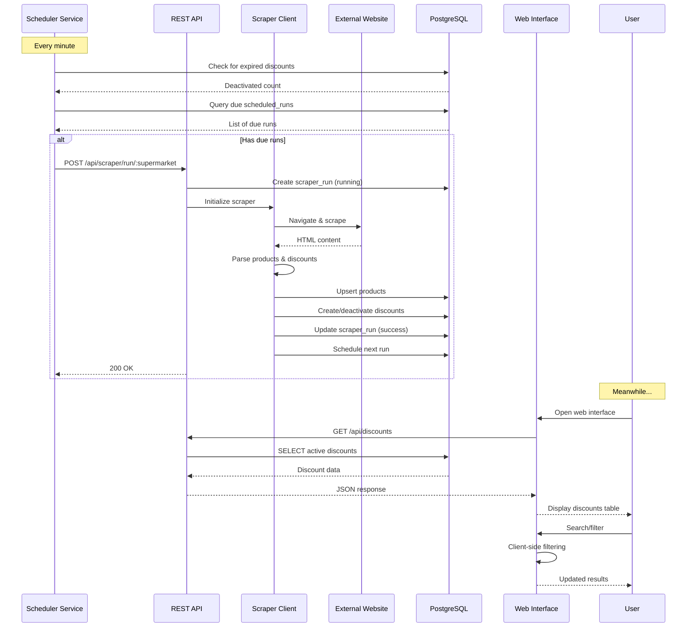
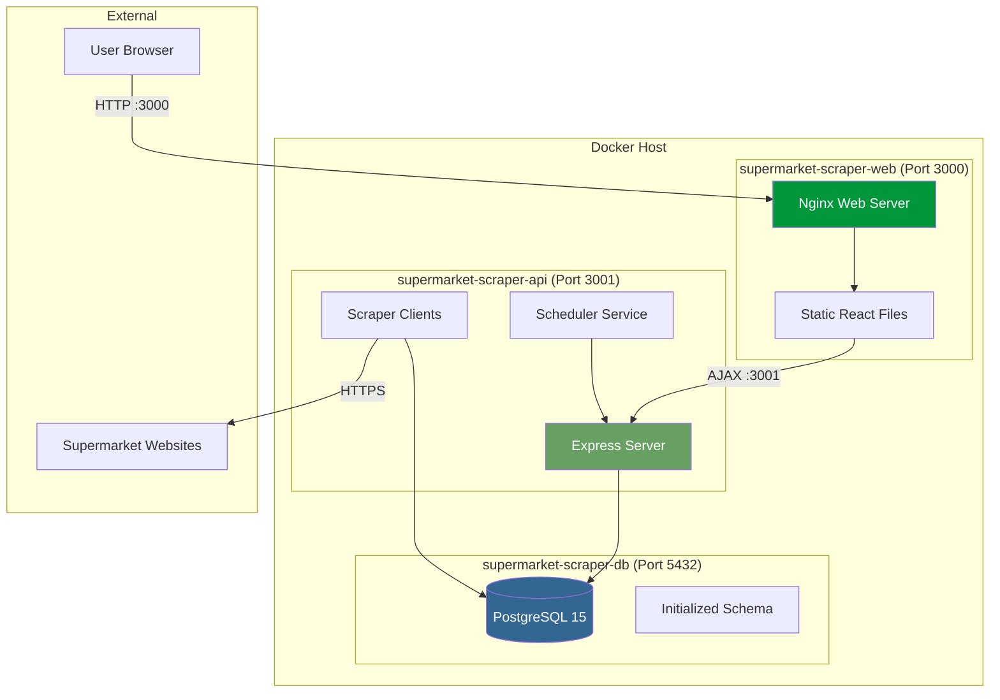

# Operations

Monitoring, non-functional requirements, integration, deployment and configuration. Part of the [functional design](../FUNCTIONAL_DESIGN.md).

## FR-006: Monitoring & Logging

| ID       | Requirement                                                           | Priority | Status         |
| -------- | --------------------------------------------------------------------- | -------- | -------------- |
| FR-006.1 | System SHALL log all scraper activities to dedicated log files        | HIGH     | ✅ Implemented |
| FR-006.2 | System SHALL track scraper run status (running/success/failed)        | HIGH     | ✅ Implemented |
| FR-006.3 | System SHALL record products scraped/created/updated counts           | HIGH     | ✅ Implemented |
| FR-006.4 | System SHALL record discounts created/deactivated counts              | HIGH     | ✅ Implemented |
| FR-006.5 | System SHALL measure and store run duration                           | MEDIUM   | ✅ Implemented |
| FR-006.6 | System SHALL capture error messages for failed runs                   | HIGH     | ✅ Implemented |
| FR-006.7 | System SHALL log server activities separately from scraper activities | MEDIUM   | ✅ Implemented |
| FR-006.8 | System SHALL support configurable log levels                          | LOW      | ✅ Implemented |

## 4.2 Non-Functional Requirements

### NFR-001: Performance

| ID        | Requirement                                                        | Priority | Status         |
| --------- | ------------------------------------------------------------------ | -------- | -------------- |
| NFR-001.1 | System SHALL return search results within 1 second                 | HIGH     | ✅ Implemented |
| NFR-001.2 | System SHALL complete scraper run within 5 minutes per supermarket | MEDIUM   | ✅ Implemented |
| NFR-001.3 | Database queries SHALL be 10-15x faster than JSON storage          | HIGH     | ✅ Implemented |
| NFR-001.4 | System SHALL support concurrent read operations                    | MEDIUM   | ✅ Implemented |
| NFR-001.5 | Web interface SHALL load within 2 seconds                          | MEDIUM   | ✅ Implemented |

### NFR-002: Reliability

| ID        | Requirement                                                         | Priority | Status         |
| --------- | ------------------------------------------------------------------- | -------- | -------------- |
| NFR-002.1 | System SHALL recover gracefully from scraper failures               | HIGH     | ✅ Implemented |
| NFR-002.2 | System SHALL continue operation if one supermarket is unreachable   | HIGH     | ✅ Implemented |
| NFR-002.3 | Database transactions SHALL be ACID-compliant                       | HIGH     | ✅ Implemented |
| NFR-002.4 | System SHALL maintain data consistency during concurrent operations | HIGH     | ✅ Implemented |

### NFR-003: Scalability

| ID        | Requirement                                                         | Priority | Status         |
| --------- | ------------------------------------------------------------------- | -------- | -------------- |
| NFR-003.1 | System SHALL support addition of new supermarkets via configuration | MEDIUM   | ✅ Implemented |
| NFR-003.2 | Database schema SHALL support thousands of products                 | HIGH     | ✅ Implemented |
| NFR-003.3 | System SHALL handle multiple concurrent web users                   | MEDIUM   | ✅ Implemented |

### NFR-004: Maintainability

| ID        | Requirement                                                   | Priority | Status         |
| --------- | ------------------------------------------------------------- | -------- | -------------- |
| NFR-004.1 | System SHALL use TypeScript for type safety                   | MEDIUM   | ✅ Implemented |
| NFR-004.2 | Code SHALL follow modular architecture patterns               | MEDIUM   | ✅ Implemented |
| NFR-004.3 | Configuration SHALL be externalized via environment variables | HIGH     | ✅ Implemented |
| NFR-004.4 | Database schema SHALL include documentation comments          | LOW      | ✅ Implemented |

### NFR-005: Usability

| ID        | Requirement                                              | Priority | Status         |
| --------- | -------------------------------------------------------- | -------- | -------------- |
| NFR-005.1 | Web interface SHALL be intuitive without training        | HIGH     | ✅ Implemented |
| NFR-005.2 | System SHALL provide visual feedback for long operations | MEDIUM   | ✅ Implemented |
| NFR-005.3 | Error messages SHALL be clear and actionable             | MEDIUM   | ✅ Implemented |

### NFR-006: Deployment

| ID        | Requirement                                          | Priority | Status         |
| --------- | ---------------------------------------------------- | -------- | -------------- |
| NFR-006.1 | System SHALL be deployable via Docker Compose        | HIGH     | ✅ Implemented |
| NFR-006.2 | System SHALL start all services with single command  | HIGH     | ✅ Implemented |
| NFR-006.3 | Database SHALL initialize automatically on first run | HIGH     | ✅ Implemented |
| NFR-006.4 | System SHALL support environment-based configuration | HIGH     | ✅ Implemented |
| NFR-006.5 | Every pull request SHALL be deployed to an acceptance environment with a fresh database of demo data; demo data SHALL never reach production | MEDIUM | ✅ Implemented |

## 6. System Integration

### 6.1 Component Interaction



### 6.2 Deployment Architecture



### 6.3 Technology Integration Points

| Integration             | Technology         | Purpose                    | Protocol                 |
| ----------------------- | ------------------ | -------------------------- | ------------------------ |
| Frontend ↔ Backend      | Axios              | API communication          | HTTP/REST                |
| Backend ↔ Database      | pg (node-postgres) | Data persistence           | PostgreSQL Wire Protocol |
| Scraper ↔ Websites      | axios              | Supermarket APIs and site data | HTTP/HTTPS           |
| Scheduler ↔ Backend     | node-cron + Axios  | Automated triggers         | HTTP (internal)          |
| Web Server ↔ Frontend   | Nginx              | Static file serving        | HTTP                     |
| Container Orchestration | Docker Compose     | Multi-container deployment | Docker API               |

---

## 9.3 Configuration Example

**.env file:**

```properties
# Database Configuration
DB_HOST=postgres
DB_PORT=5432
DB_NAME=supermarket
DB_USER=supermarket_user
DB_PASSWORD=discount_pass

# API Configuration
API_PORT=3001

# Logging Configuration
LOG_LEVEL=INFO
```

**docker-compose.yml structure:**

```yml
services:
  postgres:
    # PostgreSQL database

  scraper-api:
    # Node.js API + Scraper + Scheduler
    depends_on:
      - postgres

  web:
    # Nginx + React frontend
    depends_on:
      - scraper-api
```

---

**Document End**

_This functional design document represents the current implementation of the Supermarket Scraper system as of October 24, 2025. It should be updated as the system evolves._
