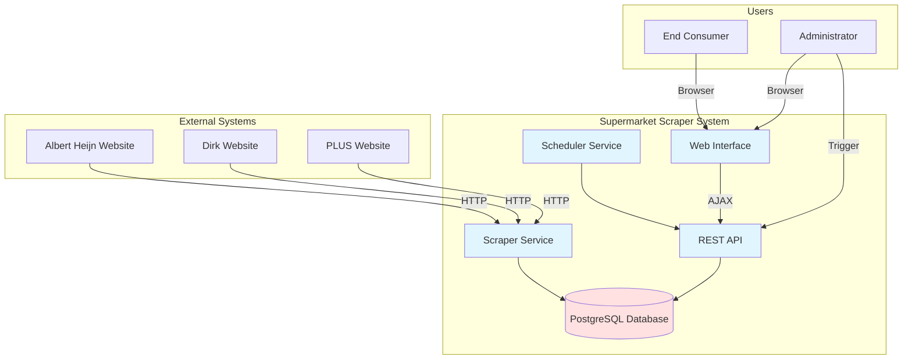

# Overview

Purpose, scope, personas and glossary of the system. Part of the [functional design](../FUNCTIONAL_DESIGN.md).

## 1. Purpose

### 1.1 System Purpose

The Supermarket Scraper system automatically collects, stores, and presents the products of multiple Dutch supermarket chains (Albert Heijn, Aldi, Dirk, Hoogvliet, Jumbo, Lidl, and PLUS) in a centralized, searchable database with a modern web interface: the full assortment with regular prices and pack quantities where a catalog scraper exists, and the weekly offers of every chain. A read-only public API serves the data to the Baskit app, which compares shopping lists on price per kilo, liter or piece.

#### Rename from discount-scraper

Until October 2026 the project was called discount-scraper, after its first
scope (weekly offers only). With the full catalogs it became a product
scraper and was renamed supermarket-scraper: GitHub repository, images
(`supermarket-scraper-db/-api/-web`), containers, NAS directories
(`/volume1/docker/supermarket-scraper`, `-acc`) and domains
(`supermarkets.shelly-nas.nl`, `supermarkets-acc.shelly-nas.nl`; the old
`discounts*` domains no longer route), database and user (`supermarket`,
`supermarket_user`) and the database volume. Nothing ran in production yet, so
nothing was migrated: production starts on a new, empty database, and Baskit
reads the API as `supermarket-scraper-api` (acc: `supermarket-scraper-acc-api`).

### 1.2 Business Goals

- **Price Transparency**: Enable consumers to compare discounts across multiple supermarkets
- **Time Savings**: Eliminate manual browsing of multiple supermarket websites
- **Data-Driven Decisions**: Provide historical discount data for trend analysis
- **Automation**: Reduce manual effort through scheduled scraping operations
- **Reliability**: Track scraper performance and maintain data quality

### 1.3 Target Audience

- **End Consumers**: Individuals looking for the best grocery deals
- **Budget-Conscious Shoppers**: Users wanting to optimize shopping expenses
- **Data Analysts**: Users interested in discount patterns and price trends
- **System Administrators**: Technical users managing scraper operations

### 1.4 Key Benefits

- Centralized view of discounts from multiple supermarkets
- Real-time discount information with expiration tracking
- Fast full-text search across products (10-15x faster than JSON storage)
- Automated scheduling with promotion-based timing
- Complete audit trail of all scraping operations
- RESTful API for potential third-party integrations

---

## 2. Scope

### 2.1 In Scope

#### Core Features

- ✅ **Web Scraping Engine**

  - Automated discount data collection from Albert Heijn, Dirk, and PLUS
  - Plain HTTP against each supermarket's own API or site data, no browser
  - Product categorization
  - Promotion expiration date extraction

- ✅ **Data Management**

  - PostgreSQL database with optimized indexing
  - Product deduplication (by name + supermarket)
  - Discount lifecycle management (active/inactive states)
  - Historical data retention
  - UPSERT logic for data updates

- ✅ **Scheduling System**

  - Cron-based scheduler (checks every minute)
  - Promotion-driven scheduling (auto-schedules next run based on expiry)
  - Manual trigger capability
  - Enable/disable per supermarket

- ✅ **REST API**

  - Discount retrieval endpoints
  - Scraper execution triggers
  - Run history and statistics
  - Dashboard metrics
  - Scheduler management

- ✅ **Product Catalog**

  - Weekly full assortment scrape with regular prices for all seven supermarkets (Albert Heijn, Aldi, Dirk, Hoogvliet, Jumbo, Lidl food assortment, PLUS)
  - Price history and catalog run tracking; on-demand runs from the "Full assortment" section of the admin UI ("Run catalog")

- ✅ **Public Consumer API**

  - Versioned read-only API under `/api/public/v1` for the Baskit app
  - Search, supermarkets, categories and product detail endpoints

- ✅ **Web Interface**

  - shelly-nas house style (design guidelines from `shelly-nas/shelly-fundamentals`), light and dark mode
  - App shell with a sidebar on desktop and a top bar with a menu drawer on phones
  - Database view with sortable columns
  - Global and per-column search
  - Discount filtering (date, category, price)
  - Configurations dashboard
  - Scraper run logs with pagination

- ✅ **Monitoring & Logging**

  - Comprehensive run tracking
  - Success/failure metrics
  - Duration monitoring
  - Product and discount counters
  - Error message capture

- ✅ **Containerization**
  - Docker Compose orchestration
  - Three-tier architecture (database, API, web)
  - Environment-based configuration

### 2.2 Out of Scope (Current Version)

#### Not Implemented

- ❌ User authentication and authorization
- ❌ User accounts and personalization
- ❌ Price alerts and notifications
- ❌ Shopping list functionality
- ❌ Mobile native applications
- ❌ Email/SMS notifications
- ❌ Multi-language support (currently Dutch-focused)
- ❌ Product image storage
- ❌ Barcode/EAN matching across supermarkets
- ❌ Price history charts/visualization
- ❌ External API rate limiting
- ❌ Data export functionality (CSV/Excel)
- ❌ Advanced analytics dashboard
- ❌ Automatic product categorization across supermarkets

### 2.3 System Boundaries

### 2.4 Technology Stack

| Layer                | Technology              | Version |
| -------------------- | ----------------------- | ------- |
| **Frontend**         | React + TypeScript      | Latest  |
| **Frontend Build**   | Vite                    | Latest  |
| **Web Server**       | Nginx                   | Latest  |
| **Backend**          | Node.js + Express       | Latest  |
| **Language**         | TypeScript              | Latest  |
| **Web Scraping**     | axios (HTTP), no browser | Latest  |
| **Database**         | PostgreSQL              | 15+     |
| **Scheduling**       | node-cron               | Latest  |
| **Containerization** | Docker + Docker Compose | Latest  |
| **HTTP Client**      | Axios                   | Latest  |

---

## 3.1 User Personas

### Persona 1: Budget-Conscious Consumer (Maria)

- **Age**: 32
- **Occupation**: Teacher
- **Tech Savvy**: Medium
- **Goals**: Save money on groceries, plan weekly shopping
- **Pain Points**: Manually checking multiple websites is time-consuming

### Persona 2: Deal Hunter (Tom)

- **Age**: 45
- **Occupation**: IT Professional
- **Tech Savvy**: High
- **Goals**: Find the absolute best deals, track discount patterns
- **Pain Points**: Wants API access, historical data

### Persona 3: System Administrator (Admin)

- **Age**: 28
- **Occupation**: DevOps Engineer
- **Tech Savvy**: Expert
- **Goals**: Ensure scrapers run reliably, monitor system health
- **Pain Points**: Needs visibility into scraper failures, run metrics

## 8. Glossary

| Term                   | Definition                                                                             |
| ---------------------- | -------------------------------------------------------------------------------------- |
| **Active Discount**    | A discount with `active=true` and `expire_date > NOW()`                                |
| **AJAX**               | Asynchronous JavaScript and XML - technique for updating web pages without full reload |
| **Cron Job**           | Time-based scheduled task                                                              |
| **CSS Selector**       | Pattern used to select HTML elements for scraping                                      |
| **Discount Lifecycle** | States: Scraped → Active → Inactive/Expired                                            |
| **Full-Text Search**   | Search technique using GIN indexes for natural language queries                        |
| **JSONB**              | PostgreSQL's binary JSON storage format                                                |
| **Scheduled Run**      | Automated scraper execution based on promotion schedules                               |
| **Scraper Run**        | Single execution of scraper for one supermarket                                        |
| **UPSERT**             | Database operation that updates if exists, inserts if not                              |
| **Web Identifiers**    | Configuration containing CSS selectors for scraping                                    |

---
