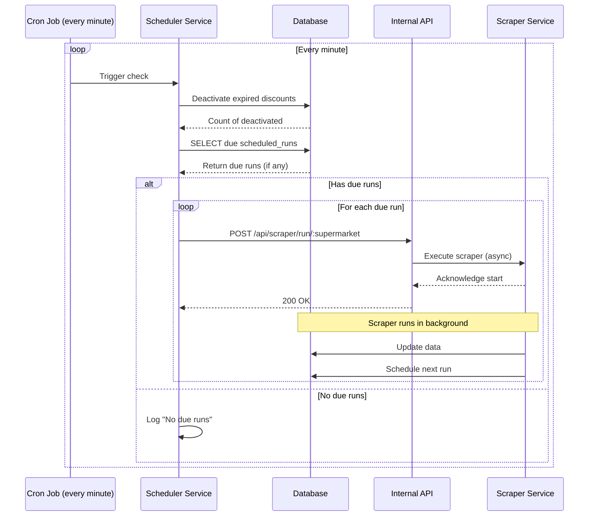

# Scheduling

Automatic re-scrapes when offers expire. Part of the [functional design](../FUNCTIONAL_DESIGN.md).

## Epic 3: Scheduled Operations

```
US-007: Automatic Scheduled Scraping
As an administrator
I want scrapers to run automatically based on promotion schedules
So that data stays fresh without manual intervention

Acceptance Criteria:
- Scrapers schedule next run based on promotion expiry (the first 03:00 after it), catalog first
- Scheduler checks every minute for due runs
- Failed runs don't block future schedules
- Logging of all automated runs
```

```
US-008: Enable/Disable Scheduled Runs
As an administrator
I want to enable or disable scheduled runs per supermarket
So that I can control when automated scraping occurs

Acceptance Criteria:
- Toggle scheduled runs on/off per supermarket
- Status persists across system restarts
- Visual indication of enabled/disabled state
- Manual runs still work when disabled
```

## Use Case 3: Automated Scheduled Scraping



**Preconditions:**

- Scheduler service is running
- At least one scheduled_run exists with enabled=true
- scheduled_run.next_run_at <= current time

**Main Flow:**

1. Cron job triggers every minute
2. Scheduler checks for expired discounts
3. System deactivates discounts where expire_date < NOW()
4. Scheduler queries scheduled_runs table for due runs
5. For each due run:
   - Scheduler sets next_run_at to a retry 3 hours later (fallback)
   - Scheduler runs the supermarket's catalog scrape and waits for it
   - Scheduler triggers the offers scraper via internal API
   - Scraper completes and sets next_run_at from the offers' end date (FR-003.2, FR-003.10)
6. Scheduler logs completion and waits for next cycle

**Postconditions:**

- Expired discounts marked as inactive
- Due scrapers executed
- Next run times updated
- All operations logged

**Alternative Flows:**

- **4a**: No due runs → Log "No due runs", wait for next cycle
- **5a**: API call fails → Log error, continue with other scrapers
- **5b**: Weekly run still in progress → Skip, check again at the retry time
- **5c**: Catalog run fails → Log error, continue with the offers run
- **5d**: Offers run fails → next_run_at stays at the retry 3 hours later

## FR-003: Scheduling System

| ID       | Requirement                                                            | Priority | Status         |
| -------- | ---------------------------------------------------------------------- | -------- | -------------- |
| FR-003.1 | System SHALL check for due scraper runs every minute                   | HIGH     | ✅ Implemented |
| FR-003.2 | System SHALL schedule the next run at the first 03:00 Europe/Amsterdam after the offers end (the run's expiry, FR-001.5), not at midnight, so the supermarket has published its new week. Measured in October 2026: AH, Lidl and Aldi end on Sunday (run Monday 03:00), Jumbo, Dirk and Hoogvliet on Tuesday (run Wednesday 03:00); Dirk's end time in UTC (23:59Z = 01:59 local) still gives Wednesday 03:00 | HIGH     | ✅ Implemented |
| FR-003.3 | System SHALL support enable/disable toggle per supermarket             | MEDIUM   | ✅ Implemented |
| FR-003.4 | System SHALL NOT run multiple instances of same scraper concurrently   | HIGH     | ✅ Implemented |
| FR-003.5 | System SHALL deactivate expired discounts on each scheduler check      | HIGH     | ✅ Implemented |
| FR-003.6 | System SHALL log all scheduler activities                              | MEDIUM   | ✅ Implemented |
| FR-003.7 | System SHALL persist scheduled run state across restarts               | MEDIUM   | ✅ Implemented |
| FR-003.8 | System SHALL trigger scrapers via internal API calls                   | MEDIUM   | ✅ Implemented |
| FR-003.9 | System SHALL run each supermarket's weekly auto run as catalog first, then offers, so regular prices and offers change on the supermarket's own week (AH Monday to Sunday, others their own); a failed catalog run does not stop the offers run | HIGH | ✅ Implemented |
| FR-003.10 | System SHALL fall back when a date is missed: (a) while a run is in progress the next run is set to a retry 3 hours later, replaced by a successful offers run, so a failed or hanging run is retried; (b) offers without an end date, or whose end date has already passed (the site still showed the old week), are fetched again 3 hours later; (c) runs are never more than 7 days apart, also when the end date is further away; (d) a run that was due while the server was down starts on the next check | HIGH | ✅ Implemented |
| FR-003.11 | System SHALL keep the per-supermarket enabled setting when a run updates the schedule, so a manual run does not switch the automatic runs back on | MEDIUM | ✅ Implemented |
