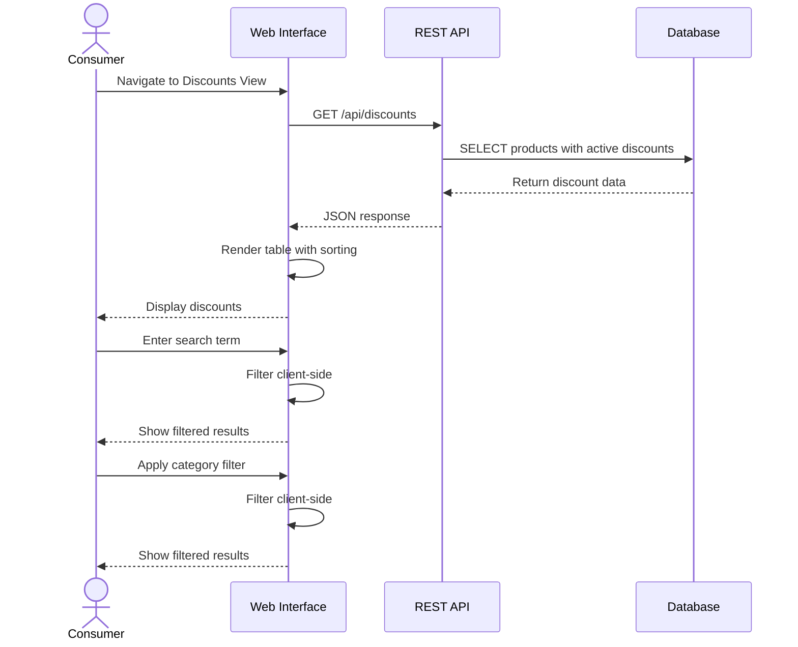
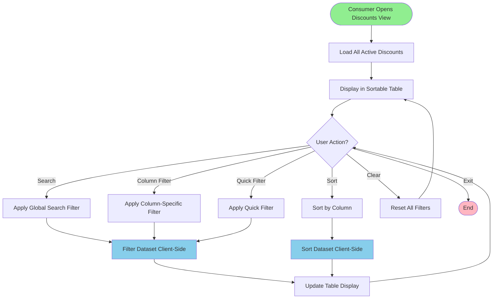

# Web interface

The admin UI: viewing and filtering discounts, configurations and runs. Part of the [functional design](../FUNCTIONAL_DESIGN.md).

## Epic 1: Discount Discovery

```
US-001: View Active Discounts
As a consumer
I want to see all active discounts from all supermarkets
So that I can find the best deals without visiting multiple websites

Acceptance Criteria:
- Display products with discount prices
- Show original price vs. discount price
- Display expiration date
- Filter by supermarket
- Search by product name
```

```
US-002: Search for Specific Products
As a consumer
I want to search for specific products by name
So that I can quickly find deals on items I need

Acceptance Criteria:
- Full-text search functionality
- Search across all supermarkets
- Display results within 1 second
- Highlight search terms in results
```

```
US-003: Filter Discounts by Criteria
As a consumer
I want to filter discounts by price range, category, and expiration date
So that I can narrow down deals relevant to me

Acceptance Criteria:
- Filter by price range (min/max)
- Filter by product category
- Filter by expiration date
- Combine multiple filters
- Clear all filters option
```

## Use Case 1: View Current Discounts



**Preconditions:**

- System is running and accessible
- At least one scraper has completed successfully
- Active discounts exist in database

**Main Flow:**

1. Consumer navigates to web interface (http://localhost:3000)
2. System loads and displays all active discounts
3. Discounts are sorted by expiration date, category, and name
4. Consumer can search by product name
5. Consumer can filter by category, price, or expiration date
6. Results update in real-time

**Postconditions:**

- Consumer views relevant discount information
- No data is modified

**Alternative Flows:**

- **3a**: No discounts available → Display "No discounts found" message
- **4a**: Search returns no results → Display "No matching products"

## Use Case 4: Search and Filter Discounts



**Preconditions:**

- Discounts data loaded in web interface
- Consumer on Discounts View page

**Main Flow:**

1. Consumer enters text in global search bar
2. System filters all columns for matching text
3. Table updates to show only matching rows
4. Consumer applies additional column filter (e.g., category)
5. System further filters results
6. Consumer clicks column header to sort
7. System sorts visible results
8. Consumer can clear all filters to reset view

**Postconditions:**

- Table shows filtered/sorted results
- Original data unchanged
- Filter state persists during session

---

## FR-005: Web Interface

| ID        | Requirement                                                        | Priority | Status         |
| --------- | ------------------------------------------------------------------ | -------- | -------------- |
| FR-005.1  | System SHALL provide web interface accessible via browser          | HIGH     | ✅ Implemented |
| FR-005.2  | System SHALL display all active discounts in table format          | HIGH     | ✅ Implemented |
| FR-005.3  | System SHALL support global search across all columns              | HIGH     | ✅ Implemented |
| FR-005.4  | System SHALL support per-column text filtering                     | MEDIUM   | ✅ Implemented |
| FR-005.5  | System SHALL support sorting by any column                         | MEDIUM   | ✅ Implemented |
| FR-005.6  | System SHALL provide quick filters (date, category, name)          | MEDIUM   | ✅ Implemented |
| FR-005.7  | System SHALL display default sorting by expiration, category, name | MEDIUM   | ✅ Implemented |
| FR-005.8  | System SHALL provide Configurations dashboard                      | MEDIUM   | ✅ Implemented |
| FR-005.9  | System SHALL display KPIs (runs, success rate, products)           | MEDIUM   | ✅ Implemented |
| FR-005.10 | System SHALL provide manual scraper trigger buttons in two sections: "Weekly offers" (current discounts, "Run offers", with an "Auto re-scrape" switch) and "Full assortment" (catalog at regular price, "Run catalog") | MEDIUM | ✅ Implemented |
| FR-005.11 | System SHALL display scraper run logs with pagination              | MEDIUM   | ✅ Implemented |
| FR-005.12 | System SHALL follow the shelly-nas design guidelines (`shelly-fundamentals`, skill `design-richtlijnen`): Figtree, color roles from `tokens.css`, components from `components.css`, status as dot plus word | LOW | ✅ Implemented |
| FR-005.13 | System SHALL be responsive for mobile devices                      | LOW      | ✅ Implemented |
| FR-005.14 | System SHALL provide confirmation dialog before running scrapers   | MEDIUM   | ✅ Implemented |
| FR-005.15 | System SHALL display an external link icon next to product names that opens the supermarket offer page | LOW | ✅ Implemented |
| FR-005.16 | System SHALL show a product thumbnail (through the image proxy) next to product names, with a placeholder icon when there is no image | LOW | ✅ Implemented |
| FR-005.17 | System SHALL offer a system, light and dark theme, remembered per browser, applied before the first paint so dark mode never flashes white | LOW | ✅ Implemented |
| FR-005.18 | System SHALL show skeletons while loading, and an empty or error state that says what happened and what to do next (with "Try again" on errors) | LOW | ✅ Implemented |
| FR-005.19 | System SHALL show failed actions (offers run, schedule toggle, catalog start) as an inline error alert on the page instead of a browser popup | LOW | ✅ Implemented |
| FR-005.20 | System SHALL show the pack size under the product name and the discount price per kilo, liter or piece in its own column (from the product's `quantity_value`/`quantity_unit`; "—" without a known quantity) | MEDIUM | ✅ Implemented |
